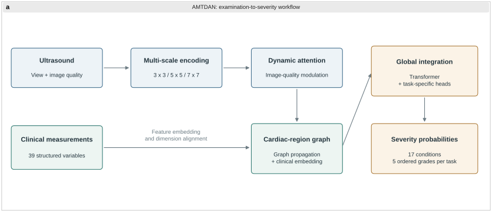
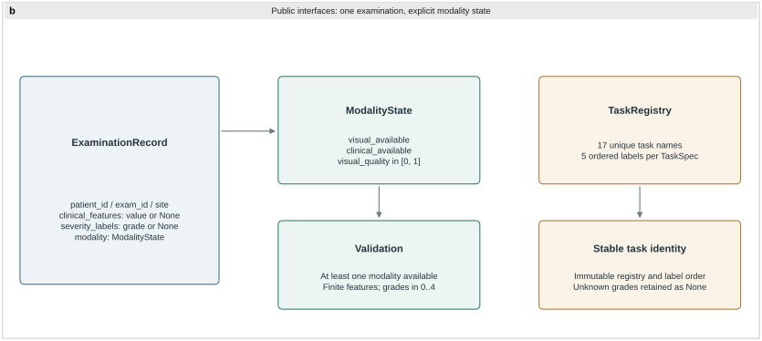
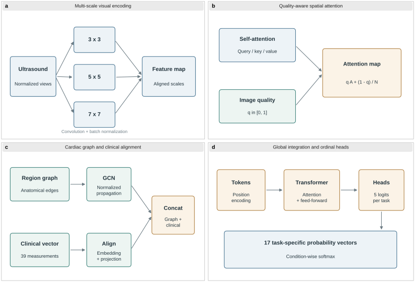
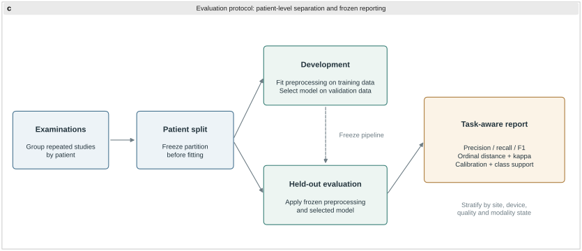
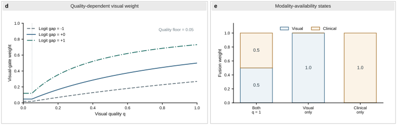

<div align="center">

# AMTDAN

**Adaptive multi-task dynamic attention for cardiac disease severity classification**

[](#release-status)
[](#task-formulation)
[](#task-formulation)
[](#multimodal-input-contract)
[](#public-utility-layer)

<sub>Multi-scale visual encoding · quality-aware attention · cardiac graph reasoning · Transformer integration</sub>

</div>

<p align="center">
  <a href="#research-overview">Overview</a> ·
  <a href="#architecture">Architecture</a> ·
  <a href="#reported-results">Results</a> ·
  <a href="#evaluation-protocol">Evaluation</a> ·
  <a href="#public-utility-layer">Code</a> ·
  <a href="docs/FIGURES.md">Figures</a>
</p>

AMTDAN combines cardiac ultrasound representations with 39 structured clinical measurements to assess five-level severity across 17 cardiac conditions. Multi-scale visual features pass through quality-aware attention and cardiac-region graph encoding, then enter a Transformer integration module with condition-specific prediction heads.

Developed in collaboration with **PLA General Hospital**, the project addresses examinations with coexisting abnormalities and different severity distributions. Its model design retains local image detail, quantitative measurements, anatomical relationships and task identity throughout the prediction pathway.

## At a glance

| Component | Specification |
|:---|:---|
| Visual modality | Cardiac ultrasound representations with view and quality information |
| Clinical modality | 39 structured measurements in the model design |
| Prediction space | 17 conditions, each with five ordered severity levels |
| Integration | Multi-scale encoding, dynamic attention, graph propagation and Transformer blocks |
| Public package | Examination contracts, task registries, modality gating and evaluation utilities |

## Research overview

<p align="center">
  <br>
  <sub>Figure 1. Model design linking ultrasound features and clinical measurements to 17 condition-specific severity distributions.</sub>
</p>

Ultrasound describes morphology, motion and flow-related appearance. Structured measurements supply dimensions, velocities, gradients and functional indices. Their contributions vary with view quality, measurement availability and the condition being assessed. AMTDAN models these sources jointly while preserving a separate output distribution for every condition.

Severity is ordered within each task. An adjacent-grade error and a distant-grade error carry different information, even when both count as categorical mistakes. The evaluation therefore includes severity distance and ordinal agreement alongside classification metrics.

## Task formulation

The five severity positions are **Mild → Mild–moderate → Moderate → Moderate–severe → Severe**. Each condition uses an ordered label registry with task-specific annotation definitions.

For examination $i$, the intended model output is

$$
\mathbf{P}_i \in [0,1]^{17 \times 5},
\qquad
\sum_{k=1}^{5} P_{i,t,k}=1,\quad t=1,\ldots,17.
$$

One examination can have labels for several conditions. Each condition retains its own probability vector and class support. Missing task labels are represented as `None` in the public examination record.

## Multimodal input contract

<p align="center">
  <br>
  <sub>Figure 2. Typed interfaces implemented in <code>amtdan/datasets/schema.py</code>.</sub>
</p>

### Visual representation

The model design uses normalized ultrasound representations with view and acquisition metadata. The public `ModalityState` contract records visual availability and an optional quality value between zero and one. Source images and visual encoder tensors belong to the experimental pipeline.

### Structured clinical representation

The model design uses 39 clinical measurements. In the public package, `clinical_features` is a named mapping of finite values or `None`. Field names, units and examination windows are defined by the study schema.

### Modality state and quality

At least one modality must be available. `ExaminationRecord` binds modality state, clinical features and severity labels to `patient_id`, `exam_id` and `site`. `TaskRegistry` holds 17 unique tasks, and each `TaskSpec` supplies five ordered label names. The registry and its label order retain their validated values after construction.

The field definitions and study-level checks are described in [Data interface](docs/DATA_INTERFACE.md).

## Architecture

<p align="center">
  <br>
  <sub>Figure 3. The four model modules and their feature transformations.</sub>
</p>

### 1. Multi-scale feature extraction

Parallel 3×3, 5×5 and 7×7 convolutional paths capture local boundaries, intermediate structures and wider cardiac context. Their normalized outputs are aligned and concatenated into a shared feature map.

### 2. Dynamic attention fusion

Self-attention relates visual locations through query, key and value representations. The image-quality branch modulates the attention allocation between learned attention and a uniform component. The resulting features retain both examination content and image reliability for regional encoding.

### 3. Graph-based structural encoding

Cardiac regions form graph nodes, with anatomical or functional relationships represented by an adjacency matrix. Normalized graph propagation aggregates regional evidence. Clinical measurements are embedded, projected to the graph feature dimension and combined with the regional representation.

### 4. Global feature integration and prediction

The multimodal representation is vectorized and combined with positional encoding. Transformer attention and feed-forward blocks integrate regional information. Task-specific heads produce five logits per condition, followed by a condition-wise softmax.

## Reported results

The existing research artifact reports the following aggregate values.

| Metric | Reported value |
|:---|:---:|
| Weighted precision | 90.5 ± 0.4% |
| Weighted F1 | 90.0 ± 0.4% |
| AUC | 93.8% |
| Cohen's κ | 0.88 ± 0.02 |

### Severity error structure

<p align="center">
  <br>
  <sub>Figure 4. Original confusion-matrix panels for PR, PAP, AR and LVDD.</sub>
</p>

The matrices retain the direction and grade distance of each error. Task-level class support and confusion matrices accompany pooled summaries so that common tasks and grades do not conceal errors in less frequent categories.

### How the metrics should be read

Precision and F1 summarize categorical performance. AUC summarizes discrimination, while Cohen's κ quantifies agreement beyond chance. Mean absolute grade error, within-one-grade agreement and quadratic-weighted κ additionally describe the ordinal structure. Calibration is assessed separately from discrimination.

## Evaluation protocol

<p align="center">
  <br>
  <sub>Figure 5. Evaluation design with patient-level partitioning, a frozen pipeline and task-aware reporting.</sub>
</p>

### Leakage-safe partitioning

Repeated examinations from the same patient remain in one partition. Patient splitting precedes preprocessing, augmentation and feature extraction. Normalization is fitted on training data, model selection uses the validation partition, and held-out evaluation applies the selected pipeline.

### Task-aware reporting

Each condition is evaluated before macro and support-weighted summaries are formed. Reports include class support, precision, recall, F1, discrimination, confusion matrices, ordinal distance, agreement and calibration. Estimates remain linked to the checkpoint, task registry and patient split used to produce them.

### Ablation design

Comparisons isolate multi-scale encoding, quality-aware attention, graph reasoning, Transformer integration and multi-task optimization under the same patient split and evaluation code. Variation across seeds or resamples accompanies point estimates.

### Domain and quality stratification

Site, device family, view, quality grade, modality availability, condition and severity define the reporting strata. The protocol is detailed in [Evaluation protocol](docs/EVALUATION_PROTOCOL.md).

## Failure analysis

| Failure mode | Diagnostic view |
|:---|:---|
| Visual quality | Performance and confidence by view and quality grade |
| Missing modality | Results by visual and clinical availability |
| Ordinal disagreement | Confusion matrices, grade distance and within-one-grade agreement |
| Domain shift | Site- and device-specific performance and calibration |
| Task imbalance | Per-task and per-class support alongside pooled metrics |

Case review retains task identity, probability vectors, modality state, quality information and annotation status. The [Failure analysis](docs/FAILURE_ANALYSIS.md) document defines the review record.

## Public utility layer

| Module | Implemented interfaces |
|:---|:---|
| [Dataset contracts](amtdan/datasets/schema.py) | `ExaminationRecord`, `ModalityState`, `TaskSpec`, `TaskRegistry` |
| [Modality gating](amtdan/models/fusion.py) | `GateWeights`, `compute_gate`, `fuse_embeddings` |
| [Evaluation](amtdan/evaluation/metrics.py) | `ordinal_metrics`, `expected_calibration_error` |

### Installation

Python 3.10 or later is required. The public package has no runtime dependencies.

```bash
git clone https://github.com/ZhWenPrism/AMTDAN.git
cd AMTDAN
python -m pip install -e .
```

### Ordinal evaluation

```python
from amtdan.evaluation import ordinal_metrics

metrics = ordinal_metrics([0, 1, 2, 3, 4], [0, 2, 2, 2, 4])
print(metrics.accuracy)
print(metrics.mean_absolute_grade_error)
```

Run the utility tests from the repository root:

```bash
python -m unittest discover -s tests -v
```

### Modality-gating response

The public `compute_gate` function defines a normalized fusion policy. With both modalities available, visual quality $q$ and quality floor $\epsilon$ enter the visual score as

$$
s_v = e^{z_v-m}\max(q,\epsilon),\qquad
s_c = e^{z_c-m},\qquad
m=\max(z_v,z_c),
$$

$$
w_v = \frac{s_v}{s_v+s_c},\qquad
w_c = 1-w_v.
$$

When one modality is absent, the available branch receives weight one. Embedding fusion uses the resulting weights for vectors with a shared dimension.

<p align="center">
  <br>
  <sub>Figure 6. Analytical outputs of <code>compute_gate</code>: logit gaps of −1, 0 and +1 with quality floor 0.05, and the equal-logit availability states.</sub>
</p>

These curves are calculated from the public function. The method's learned spatial-attention module is described separately in the architecture section. Source values and rendering details are in [Figure sources](docs/FIGURES.md).

## Repository layout

```text
AMTDAN/
├── amtdan/
│   ├── datasets/schema.py
│   ├── models/fusion.py
│   └── evaluation/metrics.py
├── assets/
│   ├── architecture.png
│   ├── results.png
│   └── figures/                     # SVG/PDF figures and analytical source tables
├── docs/
├── scripts/                        # figure renderer and layout helpers
├── tests/unit/
├── requirements-figures.txt
├── pyproject.toml
└── README.md
```

## Figure sources

The five added figures have editable SVG and PDF versions. The fusion-policy figure includes the values returned by `compute_gate`.

```bash
python -m pip install -r requirements-figures.txt
python scripts/make_figures.py
```

The renderer writes SVG, PDF, 600 dpi PNG, source tables and a rendering manifest to `outputs/figures/`. The [figure catalogue](docs/FIGURES.md) links each figure to its source.

## Release status

| Component | Current state |
|:---|:---|
| Model architecture and original aggregate-result panel | Published |
| Examination contracts, task registry, gating and evaluation utilities | Available in the public package |
| Method, interface, protocol and analytical-gating figures | SVG/PDF assets with rendering source |
| Full visual encoder, GCN, Transformer and training implementation | Pending full implementation release |
| Clinical images, private split manifests and trained checkpoints | Outside the current public artifact |

[Release scope](docs/RELEASE_SCOPE.md) describes the package contents. [Documentation](docs/README.md) provides the model card, input contract, evaluation protocol and artifact records.

<a id="scope-and-responsible-use"></a>

## Limitations

Five-level labels depend on task definitions and local annotation practice. Image quality, missing modalities, class imbalance and site or device variation remain separate axes of evaluation. Aggregate values do not resolve performance within every task, severity level or acquisition domain.
