# Paper figures

Figures from *AMTDAN: Automated classification of cardiac disease severity using ultrasound imaging and clinical data*. Figure numbers follow the manuscript.

[Project overview](../README.md) · [Documentation](README.md)

| Figure | Content |
|:---|:---|
| Fig 2 | [Model architecture](#fig-2-model-architecture) |
| Fig 5 | [Cardiac chamber and blood-flow annotations](#fig-5-cardiac-chamber-and-blood-flow-annotations) |
| Fig 6 | [Severity distributions](#fig-6-severity-distributions) |
| Fig 7 | [Multiclass training curves](#fig-7-multiclass-training-curves) |
| Fig 8 | [Binary training curves](#fig-8-binary-training-curves) |
| Fig 11 | [Multiclass ROC curves](#fig-11-multiclass-roc-curves) |
| Fig 12 | [Binary ROC curves](#fig-12-binary-roc-curves) |
| Fig 13 | [Severity confusion matrices](#fig-13-severity-confusion-matrices) |
| Fig 14 | [Disease-specific attention](#fig-14-disease-specific-attention) |
| Fig 15 | [Inter-disease knowledge transfer](#fig-15-inter-disease-knowledge-transfer) |
| Fig 16 | [Model performance and efficiency](#fig-16-model-performance-and-efficiency) |
| Fig 17 | [Robustness comparison](#fig-17-robustness-comparison) |

## Fig 2. Model architecture

Multimodal feature extraction and fusion pipeline.

## Fig 5. Cardiac chamber and blood-flow annotations

[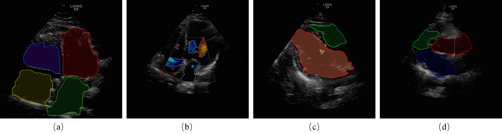](../assets/paper/fig05-annotations.png)

Standardized annotations for cardiac chambers, flow regions, and measurement reference points.

## Fig 6. Severity distributions

[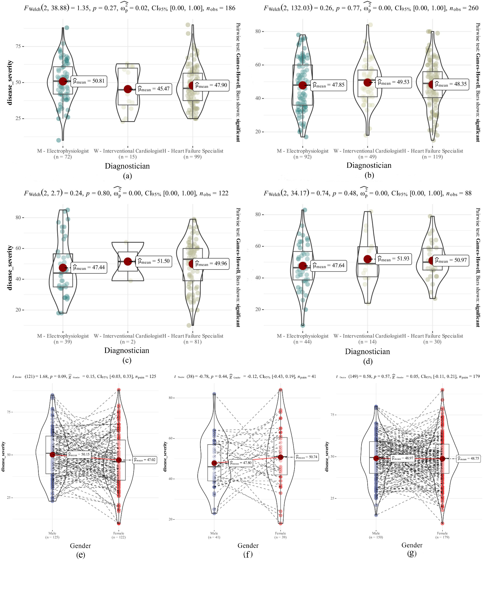](../assets/paper/fig06-severity-distributions.png)

Violin-box plots of disease severity by disease group and cardiologist category.

## Fig 7. Multiclass training curves

[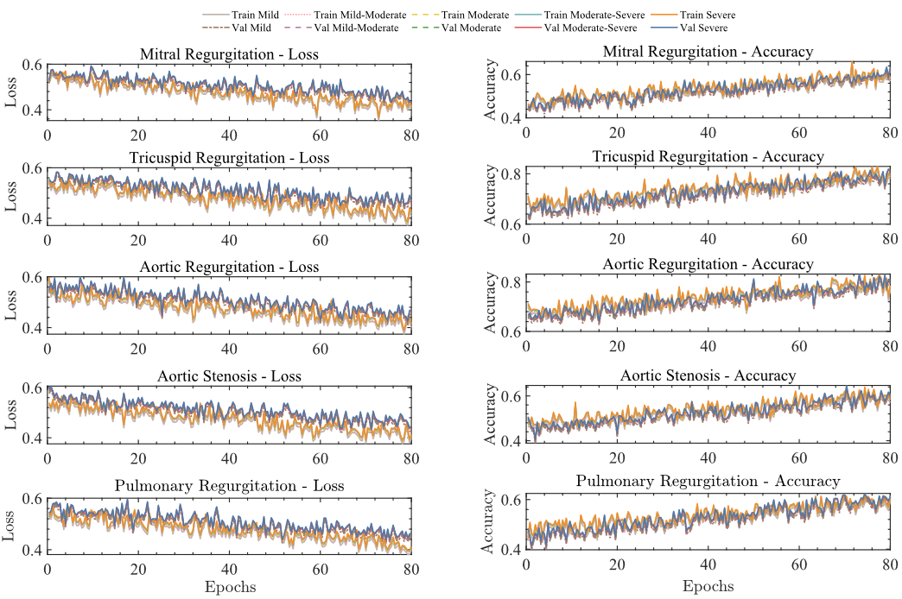](../assets/paper/fig07-multiclass-training.png)

Selected training loss and accuracy curves for multiclass classification.

## Fig 8. Binary training curves

[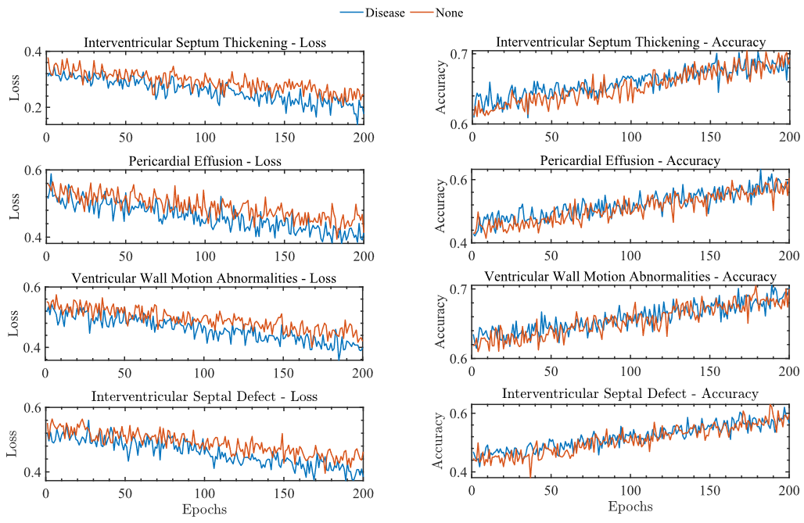](../assets/paper/fig08-binary-training.png)

Selected training loss and accuracy curves for binary classification.

## Fig 11. Multiclass ROC curves

[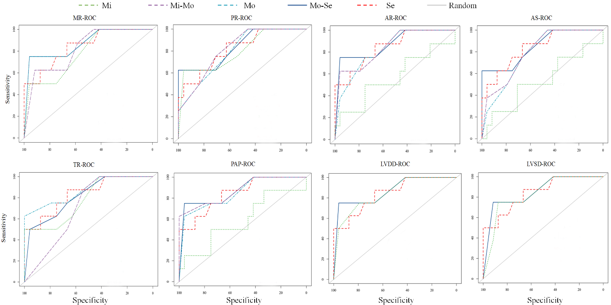](../assets/paper/fig11-multiclass-roc.png)

ROC curves for the multiclass tasks.

## Fig 12. Binary ROC curves

[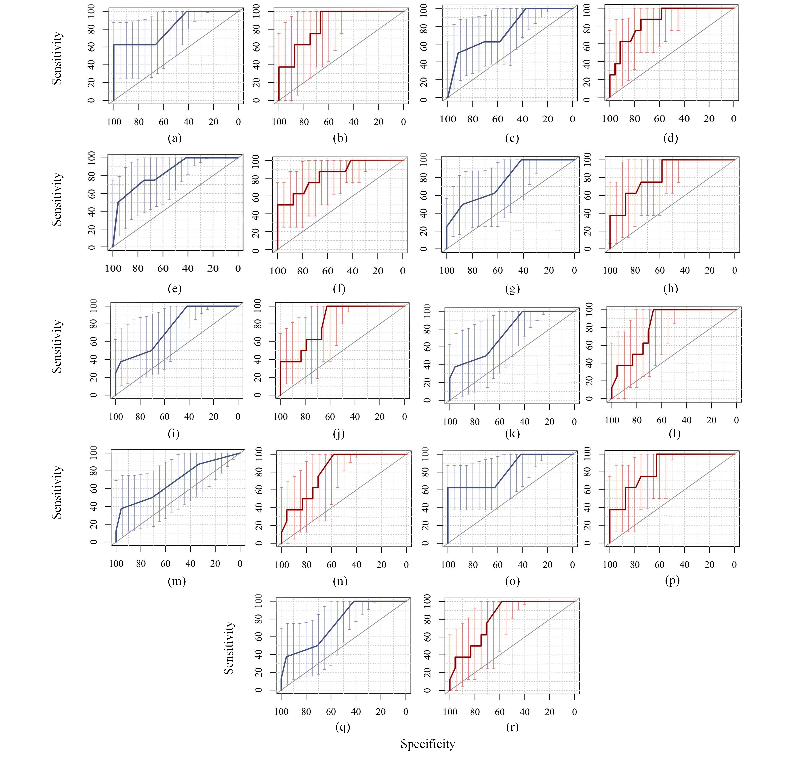](../assets/paper/fig12-binary-roc.png)

ROC curves for the binary tasks.

## Fig 13. Severity confusion matrices

[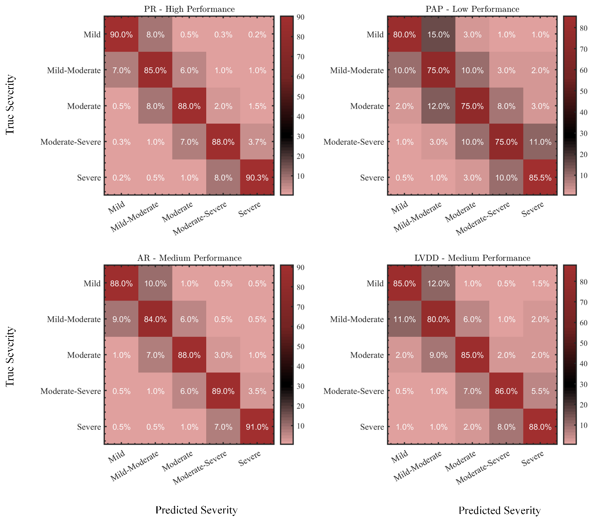](../assets/results.png)

Representative five-level severity confusion matrices.

## Fig 14. Disease-specific attention

[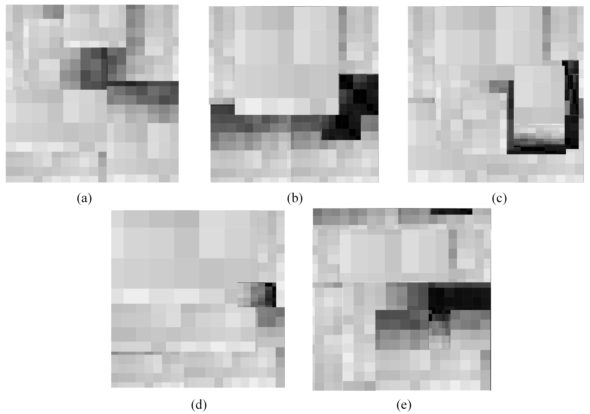](../assets/paper/fig14-attention.png)

Attention distributions for mitral regurgitation, left ventricular hypertrophy, wall motion abnormality, and aortic regurgitation.

## Fig 15. Inter-disease knowledge transfer

[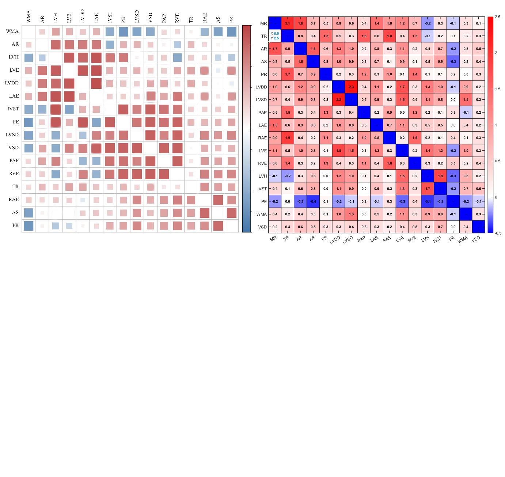](../assets/paper/fig15-knowledge-transfer.png)

Inter-disease knowledge transfer, expressed as F1 score improvement in percentage points.

## Fig 16. Model performance and efficiency

[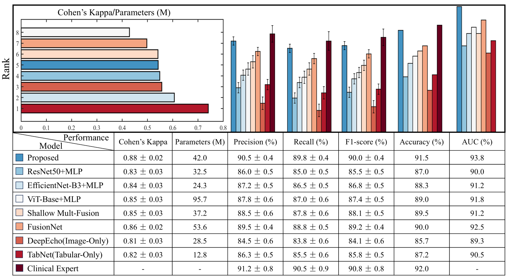](../assets/paper/fig16-model-comparison.png)

Model performance, parameter count, and Cohen's kappa comparison.

## Fig 17. Robustness comparison

[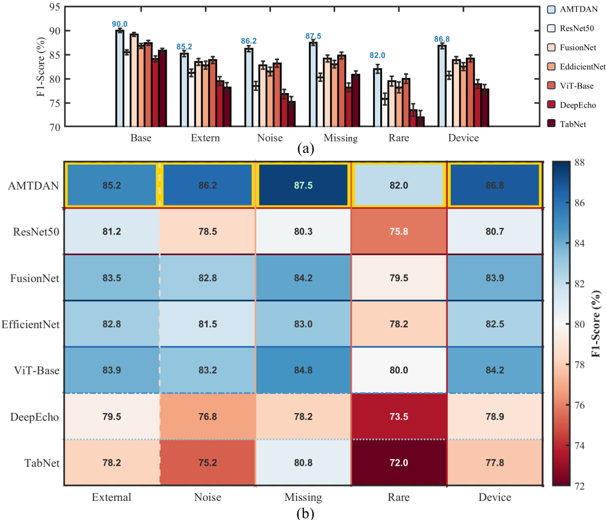](../assets/paper/fig17-robustness.png)

Model comparison across external, noise, missing-modality, rare-condition, and device test conditions.
